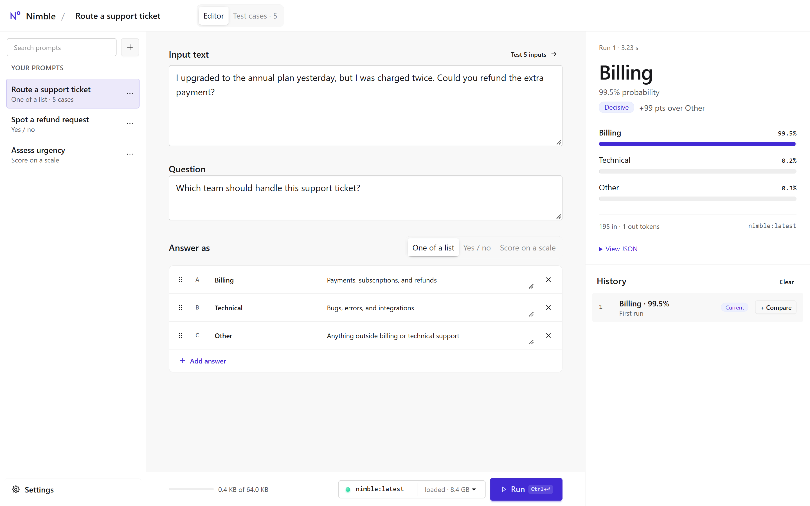
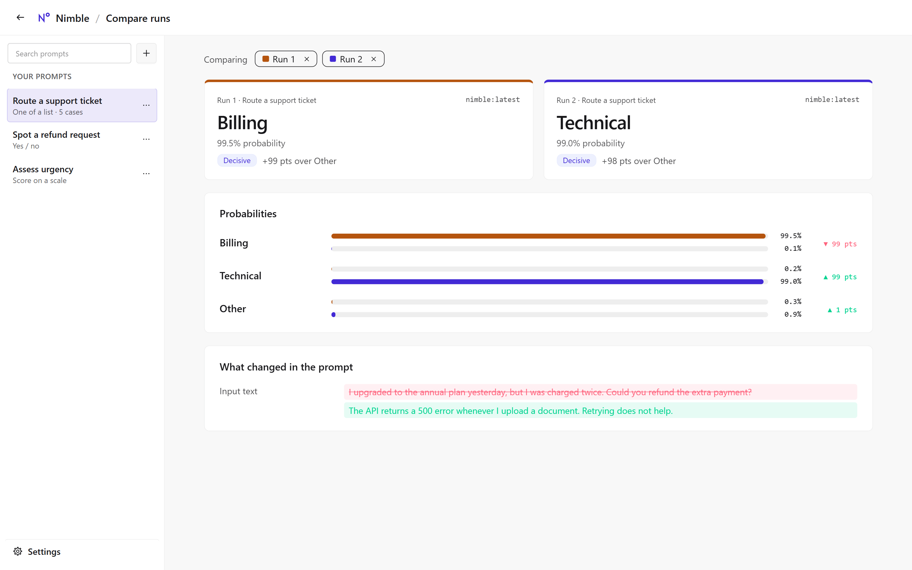
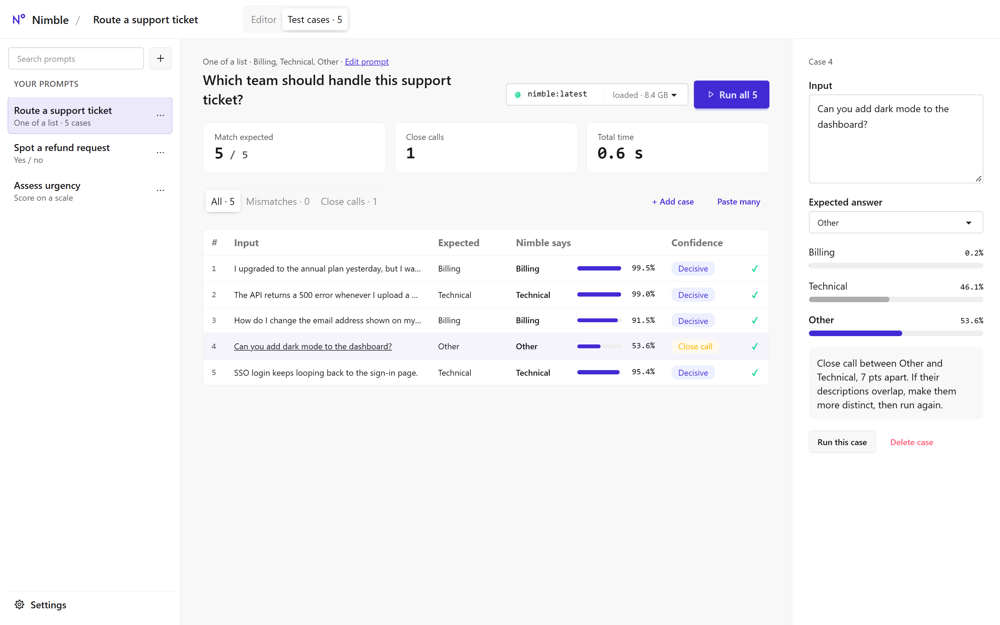

# Nimble Playground

A local React workspace for experimenting with [Nimble](https://ollama.com/library/nimble) through Ollama. Define a question and its possible answers, inspect probabilities, compare runs, and test a prompt against multiple inputs. Prompts save automatically in your browser and can be exported as JSON.



## Start locally

You need **Node.js 22.12 or newer**, **Ollama 0.35 or newer**, and the **Nimble** model.

1. [Install or update Ollama](https://ollama.com/download), then open the Ollama desktop app. For a CLI-only installation, leave `ollama serve` running in a separate terminal.
2. Download the model:

   ```sh
   ollama pull nimble
   ```

3. From this repository, install the locked dependencies and start the frontend:

   ```sh
   npm ci
   npm run dev
   ```

4. Open [http://127.0.0.1:5173](http://127.0.0.1:5173), choose **Route a support ticket** in the sidebar, and select **Run**.

The first run loads Nimble into memory and may take longer. If setup is incomplete, the app shows installation steps and checks the connection automatically while the page is visible. Installing Ollama, starting it, and downloading Nimble happen outside the browser.

## Editor and results

The sidebar contains your searchable prompt library. Select **+** to create a prompt, edit its name directly in the header, and fill in **Input text**, **Question**, and **Answer as**.

| Answer format    | Use it for                                                             | Result                                               |
| ---------------- | ---------------------------------------------------------------------- | ---------------------------------------------------- |
| One of a list    | Routing or classification with named answers and optional descriptions | Chosen answer and probability for each option        |
| Yes / no         | A binary question                                                      | Yes/no result and probability of yes (`noul`)        |
| Score on a scale | An ordered set of levels, starting at zero                             | Weighted score, most likely level, and probabilities |

Drag an answer's handle to reorder it, or focus the handle and press **↑ / ↓**. The order defines the levels of a score scale. A run evaluates one question using a snapshot of the input, question, answer definitions, and selected model.

The result panel shows elapsed time, token counts, probabilities, and **View JSON → Copy JSON**. After a second run of the same prompt, each answer also shows its change in percentage points. Editing the prompt or changing the model marks the editor's existing result as belonging to the previous run.

Confidence labels summarize the gap between the two highest probabilities: **Decisive** at 50 percentage points or more, **Leaning** from 20 to below 50, and **Close call** below 20. These are rule-based summaries of model estimates. Close-call hints suggest checking overlapping answer descriptions.

On narrow screens, the library opens as a drawer and **Edit / Result / History** tabs replace the side-by-side workspace.

## Compare runs

1. Run a prompt, change its input or instructions, and run it again. You can also compare runs from different prompts.
2. In **History**, select **+ Compare** on two to four runs.
3. Select **Compare** to see result summaries, grouped probability bars, and the changes in input, question, answers, answer order, or model.

With two runs, the probability table shows percentage-point differences. With more runs, prompt changes are compared with the first selected run. Use the back arrow or **Esc** to return to the prompt.

History retains the **50 most recent successful editor runs** for the current page session. Reloading the page clears history and comparison selections. Test-case results are shown on their own page.



## Test cases

Open **Test cases** in the header or **Test more inputs** beside the input field. Each case uses the prompt's question and answer definitions with its own input text. The support-ticket example includes five cases with expected answers.

- Use **+ Add case** or **Paste many** (one input per line), up to 100 cases per prompt.
- Select a row to edit its input and optional **Expected answer**. For a score scale, the expected answer is the most likely level's label.
- Select **Run all** to process cases sequentially, or **Run this case** for a single input. **Cancel** stops the active browser request and skips queued cases.
- Inspect the match count, close calls, and total request time. Filter by **Mismatches** or **Close calls**, then open a row to see its probabilities and any close-call hint.

Case inputs and expected answers save with the prompt. Results last for the current page session; editing the input, question, or answers marks affected results as outdated and excludes them from the current summary.



Screenshots show actual local Nimble runs using the bundled examples. Probabilities and timings can vary.

## Saving and managing prompts

Edits save after a **500 ms pause**, and switching prompts saves pending changes immediately. Incomplete drafts can be saved. A new prompt enters the library on its first edit. The name commits on **Enter** or when its field loses focus; an empty name reverts, and a duplicate name shows an inline error.

Use a prompt's **⋯** menu to **Duplicate** or **Delete** it. Duplicates receive a unique name. Deleting the open prompt selects another prompt, or a blank draft when the library is empty. The deletion notification offers **Undo** for 10 seconds; hovering or focusing the notification pauses its countdown.

Three editable examples ship in [src/data/default-prompts.json](src/data/default-prompts.json): **Route a support ticket**, **Spot a refund request**, and **Assess urgency**. They are seeded on first launch. Deleted examples stay deleted after a refresh. **Settings → Restore examples** adds missing original copies while preserving edited prompts. Clearing browser storage resets the library and its example history.

| Data                                                           | Where it lives                 |
| -------------------------------------------------------------- | ------------------------------ |
| Prompt names, drafts, and test-case definitions                | Browser `localStorage`         |
| Theme, Ollama address, and memory preference                   | Browser `localStorage`         |
| Run history, comparison selections, results, and deletion undo | Current page session only      |
| Exported prompts and test-case definitions                     | JSON file you download or copy |

Storage belongs to a specific browser and origin: `127.0.0.1:5173`, `localhost:5173`, and `127.0.0.1:4173` have separate libraries. Clearing browser data removes saved prompts. The library holds up to **100 prompts / 2 MiB**. If storage cannot be written, the app shows **Not saved** and keeps changes in the tab; export them before leaving. An unreadable existing library is preserved.

In **Settings → Export…**, choose **Download JSON** or **Copy JSON**. Exports contain prompt text and test cases, so review their contents before sharing. **Import…** validates the file, assigns new prompt IDs, and renames conflicting titles without replacing existing prompts. Version 1 exports remain supported; [examples/prompts.json](examples/prompts.json) is a minimal importable example. Run history and results are not included in prompt exports.

## Settings and shortcuts

Open **Settings** at the bottom of the sidebar, or use the gear button on narrow screens. It includes light/dark appearance, setup instructions, library import/export, and Ollama controls:

- **Address:** defaults to `http://127.0.0.1:11434`. Enter another Ollama address and select **Save**, or **Reset** to restore the default. The browser connects directly to this address.
- **Refresh connection:** checks Ollama's version, installed Nimble tags, and loaded models.
- **Keep model in memory:** choose 5 minutes, 30 minutes, or **Unload after each run**.
- **Unload model:** releases a loaded Nimble model's memory without deleting its download. Loaded models show their reported VRAM usage.

| Shortcut                             | Action                             |
| ------------------------------------ | ---------------------------------- |
| Ctrl+Enter / Cmd+Enter in the editor | Run the prompt                     |
| Ctrl+S / Cmd+S                       | Save pending changes immediately   |
| Enter / Esc in the prompt name       | Apply / cancel the name edit       |
| Esc in Compare or Settings           | Return to the previous prompt page |
| ↑ / ↓ on an answer's reorder handle  | Move that answer                   |

## Stack and architecture

**React 19 + TypeScript**, **Vite**, and **Tailwind CSS 4 + daisyUI 5**. React and React DOM are the only production JavaScript dependencies. State uses React hooks, persistence uses `localStorage`, and requests use native `fetch` with `AbortController`. There is no custom backend, database, model SDK, or router package.

```text
Browser frontend ──direct HTTP──> Ollama (default: 127.0.0.1:11434) ──> Nimble
       │
       └── localStorage / JSON prompt files
```

Vite serves frontend files. Ollama handles inference through `/v1/systemone`; the app also calls `/api/version`, `/api/tags`, `/api/ps`, and `/api/generate` for status and unloading. Model selection includes installed `nimble` tags and excludes cloud tags. Prompt requests go directly to the configured Ollama address, without a Vite proxy. The app limits each encoded decision request to **64 KiB**; larger saved drafts must be shortened before running.

| Source                                                                        | Responsibility                                                                               |
| ----------------------------------------------------------------------------- | -------------------------------------------------------------------------------------------- |
| `src/domain.ts`, `src/analysis.ts`                                            | Prompt validation, request/response types, confidence labels, probability changes, and diffs |
| `src/ollama.ts`, `src/useConnection.ts`                                       | HTTP requests, timeouts, cancellation, and connection checks                                 |
| `src/storage.ts`, `src/data/default-prompts.json`                             | Validated JSON bundles, browser persistence, and bundled examples                            |
| `src/usePromptLibrary.ts`, `src/useLibraryActions.ts`                         | Library state, save failures, import, delete/undo, and example restoration                   |
| `src/useEditorSession.ts`, `src/useDecisionRunner.ts`, `src/useRunHistory.ts` | Editor state, sequential request execution, and session history                              |
| `src/App.tsx`, `src/components/`, `src/styles.css`                            | Page composition, reusable controls, and responsive layouts                                  |

The design uses [daisyUI's UI design guidance](https://daisyui.com/codex/ui-design-skill/). Fonts and icons are local; the app has no analytics or external runtime assets.

## Development

```sh
npm run check         # TypeScript checks
npm test              # Domain, analysis, storage, HTTP, and UI tests
npm run format:check  # Check formatting
npm run format        # Apply formatting
npm run build         # Type-check and build static assets into dist/
npm run preview       # Inspect the build at http://127.0.0.1:4173
```

Tests use Vitest and Testing Library with mocked Ollama responses, so they need no GPU or model download. CI runs formatting, tests, and the production build on Linux and Windows; it does not deploy the app.

Serve the built files over HTTP. Opening `dist/index.html` with `file://` is unsupported. Vite's preview command is for checking the build and uses a separate browser-storage origin from the dev server.

To refresh the screenshots, use the production preview with bundled examples, run an editor decision, compare two runs, and run the support-ticket cases. Replace `docs/screenshot.png`, `docs/compare.png`, and `docs/test-cases.png` with captures of those views. Use a 1440 × 900 viewport at 2× device scale to produce lossless 2880 × 1800 PNGs without resizing or JPEG compression.

## Troubleshooting

- **Cannot reach Ollama:** open the Ollama app or run `ollama serve`, then check **Settings → Address**. The browser cannot distinguish a stopped service from a missing installation or blocked connection.
- **Nimble missing:** run `ollama pull nimble`, wait for the download, then use **Check now** in setup or **Refresh connection** in Settings.
- **Decision endpoint missing:** check `ollama --version`, update to 0.35 or newer, and restart Ollama.
- **Browser blocks the request:** allow local-network access if prompted. If you customized `OLLAMA_ORIGINS`, include the exact frontend origin and restart Ollama. A local frontend can use loopback without exposing Ollama to the network.
- **Port 5173 already used:** stop the other frontend process or change the port deliberately. The strict-port setting prevents silently switching to a different prompt-storage origin.
- **Slow first run or memory pressure:** allow time for loading, close other GPU workloads, or unload Nimble. Each decision has a three-minute timeout. Cancelling aborts the browser request; Ollama may take a moment to stop processing.
- **Export did not download:** check browser download permissions or use **Copy JSON** and save the text as a `.json` file. The JSON remains selectable if clipboard access is blocked.

## References and license

- [Ollama decision API announcement and protocol examples](https://ollama.com/blog/ollama-now-supports-jev-style-decision-models)
- [Nimble model](https://ollama.com/library/nimble)
- [Ollama API reference](https://docs.ollama.com/api)
- [daisyUI](https://daisyui.com/)

MIT license for this application; see [LICENSE](LICENSE). Ollama, Nimble, and dependencies retain their own licenses. This is an independent playground, not an official Ollama or Bespoke Labs application.

## AI disclosure

Nimble Playground was built using OpenAI Codex and Anthropic Claude. The implementation was reviewed and verified with human input.
